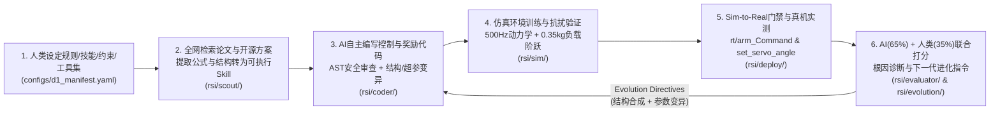

# 物理AI机器人自进化 V1.0 (Physical AI Robot Self-Evolution V1.0) — 架构设计白皮书

> **项目代号**: `Physical-AI-RSI-Unitree-D1`  
> **所属组织**: 桦之坚 (Huazhijian)  
> **目标本体**: 宇树 Unitree D1 机械臂 (6-DOF 旋转关节 + 1-DOF 平行夹爪，板载 7× FashionStar UART 总线舵机 `/dev/ttyS4`)  
> **集群协同**: `4gpu (10.10.218.4)` 4×RTX 4090 训练/评测底座 + `1F unitree-d1-1..3 (10.10.137.101..103)` 实体机械臂集群

---

## 1. 核心设计范式：六阶段“感知—决策—执行—评估—学习—进化”闭环

---

## 2. 与 `4gpu` 及 1楼 `unitree-d1-1..3` 真实工程资产对齐清单

本框架直接吸纳并复用了 `4gpu (10.10.218.4)` 与 `1F unitree-d1-1..3 (10.10.137.101..103)` 上已验证的核心工程契约：

| 层级 | 远端真实路径 / 节点 | 提炼并沉淀至 RSI V1.0 的核心机制 |
| :--- | :--- | :--- |
| **7D 状态-动作契约** | `4gpu:/mnt/nvme0n1/gy/d1_smolvla_automation/runtime-pending-blend-v1/normalization_contract.py` | 强制校验 `d1_absolute_state_action_7d_v1`（6 轴关节角 + 1 轴夹爪行程，全有限值检查） |
| **Horizon-3 延迟补偿与双帧确认释放** | `4gpu:/mnt/nvme0n1/gy/d1_smolvla_automation/reopen35-v1/` | `action_horizon=3, response_horizon=13` 传输延迟跳过机制 + **双帧观测确认释放门控**（防止夹爪提前松球） |
| **ACT 多分块动作对比训练** | `4gpu:/mnt/nvme0n1/gy/d1_act_code/scripts/run_d1_act_comparison_plan.py` | 支持只抓、只放、抓+放三阶段分解与夹爪释放权重调优 |
| **$\pi_{0.6}$ + RECAP 优势加权自进化** | `4gpu:/mnt/raid30t/gy/dual_arm_workcell/code/openpi_d1_recap_publish/` | 基于进度值函数的优势标注 $A(s,a) = V(s') - V(s)$ 与带安全护栏的 HITL Rollout |
| **宇树 D1 板载 DDS 通信与舵机驱动** | `unitree-d1-1:/home/ubuntu/marm_code/src/marm_communication_node.cpp` & `teleop_direct` | 高层 JSON Topic `rt/arm_Command` (`funcode=2` 七轴控制、`funcode=5` 阻尼保护、`funcode=7` 回零) 与底层 `set_servo_angle` (`SetServoAngle_`, 动态 `delay_ms`) |

---

## 3. 阶段 2 从论文与开源库自动提取的 5 条核心数学控制律

1. **奇异鲁棒阻尼最小二乘逆运动学与零空间姿态投影 (Singularity-Robust DLS-IK)**:
   $$\dot{q}_{des} = J^T (J J^T + \lambda^2 I)^{-1} (\dot{x}_{ref} + K_x e_x + f_{rep}(z)) + (I - J^\dagger J)\bigl(-k_{null}(q - q_{home})\bigr)$$
2. **操作空间计算力矩 PD + 重力前馈 + 在线递归负载质量观测器 (Adaptive Payload Observer)**:
   $$\tau = K_p (q_{des} - q) + K_d (\dot{q}_{des} - \dot{q}) + K_i \int (q_{des} - q)\,\mathrm{d}t + G(q, \hat{m}_{load}), \quad \dot{\hat{m}}_{load} = \gamma_{adapt} J_z^T(q) e_z$$
3. **Horizon-3 动作分块延迟补偿与双帧确认释放门控 (Two-Observation Adaptive Release Gate)**:
   $$a_{exec}(t) = \hat{A}_{t - k_{delay}}[k_{delay} : k_{delay} + 3], \quad u_{reopen}(t) = \mathbb{I}\bigl(\|e_{place}(t)\|_2 < \epsilon \land \|e_{place}(t-1)\|_2 < \epsilon\bigr)$$
4. **五次多项式最小加加速度轨迹与桌面防碰撞排斥势场 (Minimum-Jerk & Table Barrier)**:
   $$s(u) = 10u^3 - 15u^4 + 6u^5, \quad U_{rep}(z) = \frac{1}{2} k_{rep} \left(\frac{1}{z - z_{table}} - \frac{1}{z_0}\right)^2$$
5. **Eureka + RECAP 多维分解密集奖励函数 (Decomposed Evolutionary Fitness)**:
   $$R_{Eureka} = w_{track} \exp(-\alpha \|e_x\|_2) + w_{payload} \exp(-1.2\alpha \|e_{load}\|_2) + w_{smooth} \exp(-\beta \|\dot{\tau}\|_2) + w_{grasp} \mathbb{I}_{grasp} - w_{barrier} \Phi_{violation}$$
